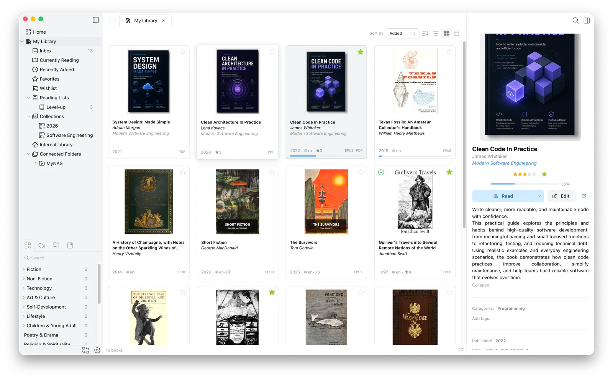

# Papyrium – Releases

> **Public beta** — your feedback shapes what comes next. See [Issues & Feedback](#issues--feedback).

  <picture>
    <source media="(prefers-color-scheme: dark)" srcset="assets/hero-dark.webp">
    
  </picture>

This repository distributes official Papyrium builds and tracks issues. It does **not** contain application source code.

🌐 **Website:** [papyriumlib.com](https://papyriumlib.com) · 📖 **Docs:** [Getting Started](https://papyriumlib.com/docs/getting-started) · [FAQ](https://papyriumlib.com/docs/faq)

## About Papyrium

Papyrium is a desktop app for building and managing your personal digital book library — designed for readers who want more than a folder of files. It supports **PDF, EPUB, and FB2**.

### Library management
- Internal library — a built-in managed folder with an Inbox for dropping in new books
- Works with your existing folders — connect a local folder or NAS share and Papyrium indexes it in place. Your files stay where they are, your folder structure is preserved.
- Keep chosen books offline — they stay readable when the external drive or NAS is disconnected
- Automatic metadata and cover extraction, plus matching OPF files — a Calibre library brings its tags, series, and ratings along
- Edit any book's metadata, cover included, and compare it with what's stored in the file
- Organize with tags, categories, collections, and series
- Smart collections that auto-populate based on reading status, rating, format, tags, date added, and more
- Link editions and translations of a book to each other
- Search with filters
- Duplicate detection — same ISBN, identical files, or matching title and author; the import window flags books you already have

### Built-in reader
- Read files without leaving the app
- Text selection, color highlights, and notes on highlights
- Freeform per-page notes, and PDF markup tools (ink, arrows, text)
- Bookmarks and automatic reading-progress tracking

### Reading workflow
- Track what you're reading, finished, and planning to read
- "Currently Reading", "Recently Added", and "Favorites" smart collections out of the box
- Per-book notes panel

### AI agent connection (MCP)
- Connect your own AI agent — Claude Code, Codex, or Claude Desktop via a built-in one-click setup — to search and browse your library
- Read-only by default; editing and deleting each need a separate opt-in, and moving, merging, or trashing books starts as a dry-run preview
- Every change an agent makes is logged, and most edits can be undone with one click
- Only metadata, file paths, and your own annotations are exposed — never the full text of your books, and Papyrium has no built-in AI assistant of its own

## Requirements

- **macOS 12 (Monterey) or later**
- **Apple Silicon** (M1 or newer) — Intel Macs are not supported

## Download & Install

1. Download the latest `.dmg` from the [Releases](https://github.com/papyrium/papyrium-releases/releases) page.
2. Open the `.dmg` and drag **Papyrium** into your Applications folder.
3. Launch it. On first run macOS shows a one-time "downloaded from the Internet" prompt — click **Open**.

Papyrium is signed with an Apple Developer ID and notarized, so there's no "unidentified developer" workaround. The app checks for updates automatically — you won't need to re-download manually.

## Pricing

See [pricing](https://papyriumlib.com/#pricing) on the website.

## Terms and privacy

Using Papyrium is subject to the [Terms of Use](https://papyriumlib.com/terms) and the [Privacy Policy](https://papyriumlib.com/privacy).

## Issues & Feedback

Feedback is genuinely appreciated — every bug report, feature idea, and rough impression is read, and it's how Papyrium gets better.

- 🐞 [Report a bug](https://github.com/papyrium/papyrium-releases/issues/new?labels=bug)
- 💡 [Request a feature](https://github.com/papyrium/papyrium-releases/issues/new?labels=enhancement)
- ✉️ Email [feedback@papyriumlib.com](mailto:feedback@papyriumlib.com)
- 💬 Discuss on [r/Papyrium](https://www.reddit.com/r/Papyrium/)

Including your macOS version, your Papyrium version (in the About menu), and a screenshot helps a lot.
